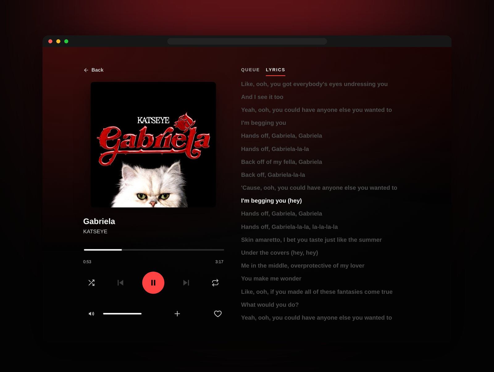
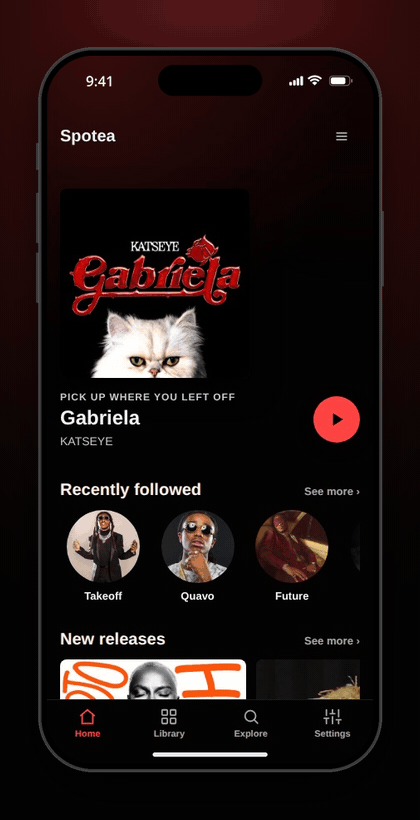
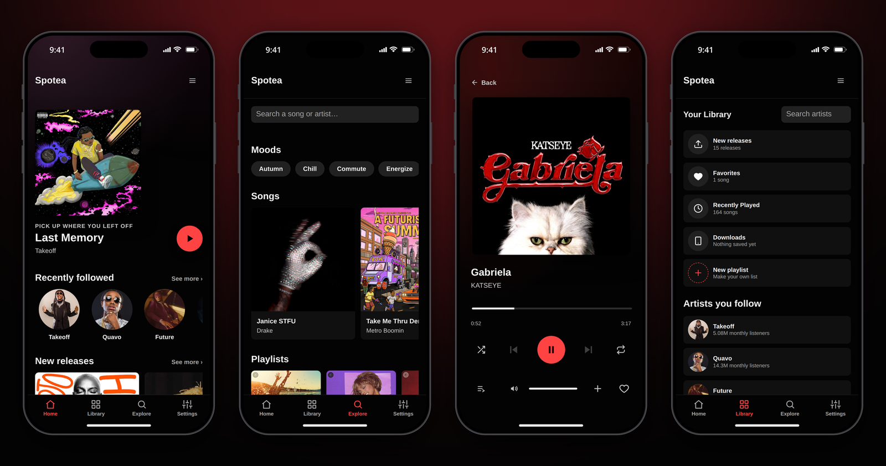

<p align="center">
  
</p>

<h1 align="center">Spotea</h1>

<p align="center">
  <b>Your own music streaming app.</b><br>
  Built on YouTube Music. Self-hosted, free, and it keeps playing offline.
</p>

<p align="center">
  <a href="https://github.com/sertacartun/spotea/actions/workflows/tests.yml"></a>
  <a href="LICENSE"></a>
  
</p>

<p align="center">
  
</p>

## Why Spotea?



- 🎤 **Follow artists.** New releases from the artists you follow show up on Home.
- 🔎 **Explore the whole catalogue.** Search YouTube Music for songs, artists, albums, charts and moods.
- ✨ **Recommendations based on who you follow.** Explore suggests songs and artists from your library.
- 📝 **Synced lyrics.** Lyrics scroll along with the song.
- 🎶 **Your own playlists.** Plus Favorites and Recently Played.
- 📥 **Download lists to your phone.** Favorites, your playlists, albums and more play with no connection; downloads stay on your disk for good and export as one zip.
- 🧹 **Played songs are a cache.** Anything you only played is cleared a week after its last play.
- 📱 **Installs like an app.** Add it to your home screen on iOS or Android.

<br clear="right">

<p align="center">
  
</p>

## Get started

You only need [Docker](https://docs.docker.com/get-docker/).

```bash
git clone https://github.com/sertacartun/spotea.git && cd spotea
docker compose up -d
```

Open **http://localhost:8000** and create your account. That's it.

To update later: `git pull && docker compose up -d --build`. Your music in `./data` stays.

### Without git (NAS, Portainer, …)

Prebuilt images for amd64 and arm64 are on GitHub Container Registry, so a single compose file is enough. Paste this into your NAS's Compose/Project screen, or save it as `docker-compose.yml` in an empty folder and run `docker compose up -d`:

```yaml
services:
  spotea:
    image: ghcr.io/sertacartun/spotea:latest
    ports:
      - "8000:8000"
    volumes:
      # Portainer and some NAS UIs need an absolute path here,
      # e.g. /volume1/docker/spotea/data:/app/data on Synology.
      - ./data:/app/data
    restart: unless-stopped
```

Open **http://&lt;your-server&gt;:8000** and create your account. Any setting from the [configuration table](docs/SELF_HOSTING.md#configuration) goes under `environment:`.

To update later: `docker compose pull && docker compose up -d`, or your NAS's "pull image" / "recreate" action.

> [!NOTE]
> If you add `user: "UID:GID"` (common on Synology and Unraid), create the `data` folder first and give that user ownership of it. Otherwise the app can't write its files and keeps restarting.

## More

- [Self-hosting guide](docs/SELF_HOSTING.md): HTTPS with Tailscale, configuration, running without Docker
- [Architecture](ARCHITECTURE.md): how it works inside
- [Contributing](CONTRIBUTING.md)

## License

MIT. See [LICENSE](LICENSE).
